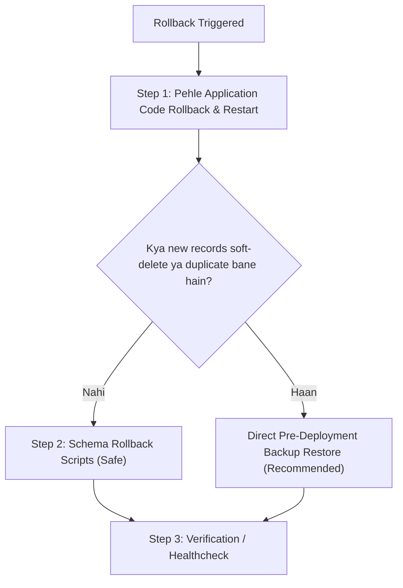

# ShreeHK ERP — Production Rollout Checklist

**Target Database:** `shreehkweb_snj2024_test`  
**Applicable Service:** `ShreeHK_BackEnd`  
**Feature:** Universal Soft-Delete Architecture & Schema Migration (Phases 1–4)

---

## 1. Pre-Deployment Prerequisites

> [!CAUTION]
> Always take a full database dump before executing any DDL schema migrations on production.

1. **Database Backup & Offsite Storage (Server Ke Bahar Copy):**
   - Full database dump execute karein:
     ```bash
     mysqldump -u <user> -p --single-transaction --quick --routines --triggers shreehkweb_snj2024_test > shreehkweb_snj2024_test_pre_softdelete_$(date +%Y%m%d_%H%M%S).sql
     ```
   - **Server Ke Bahar Copy (Mandatory Offsite Storage):** Backup file ko production server ke bahar kisi alag safe storage (e.g. dedicated backup server, S3 bucket, ya secure local machine) par copy karein:
     ```bash
     scp shreehkweb_snj2024_test_pre_softdelete_*.sql backup-server:/var/backups/shreehk/
     ```

2. **Backup Restore Test (Alag Test DB Me Restore Verification):**
   - Production migration run karne se pehle, backup file ko ek alag temporary/staging database par restore karke verify karein ki backup file 100% valid hai aur properly restore hoti hai:
     ```bash
     mysql -u <user> -p -e "CREATE DATABASE IF NOT EXISTS shreehk_backup_verify;"
     mysql -u <user> -p shreehk_backup_verify < shreehkweb_snj2024_test_pre_softdelete_*.sql
     mysql -u <user> -p -e "SELECT COUNT(*) FROM shreehk_backup_verify.dai_product; DROP DATABASE shreehk_backup_verify;"
     ```

3. **Capture Pre-Migration Baseline Row Counts:**
   Migration ke pehle table-wise exact row counts record karein:
   ```sql
   SELECT 'dai_product' AS tbl, COUNT(*) AS cnt FROM dai_product
   UNION ALL SELECT 'dai_inward', COUNT(*) FROM dai_inward
   UNION ALL SELECT 'dai_outward', COUNT(*) FROM dai_outward
   UNION ALL SELECT 'acc_transaction', COUNT(*) FROM acc_transaction
   UNION ALL SELECT 'acc_advance', COUNT(*) FROM acc_advance
   UNION ALL SELECT 'dai_party', COUNT(*) FROM dai_party
   UNION ALL SELECT 'user', COUNT(*) FROM user
   UNION ALL SELECT 'branch', COUNT(*) FROM branch
   UNION ALL SELECT 'company', COUNT(*) FROM company;
   ```

4. **Verify Disk Space:**
   Ensure at least 5 GB free disk space for table ALTER operations (particularly large tables like `dai_activity_log` with 80k+ rows).

5. **Maintenance Window:**
   Schedule a standard 10–15 minute maintenance window during off-peak hours.

---

## 2. Step-by-Step Rollout Sequence

### Step 1: Run Schema Migration
Run the idempotent schema migration script. The script strictly requires the `--confirm-db` flag matching the target database name to prevent accidental execution.

```bash
cd ShreeHK_BackEnd
node scripts/migrateUniversalSoftDelete.js --confirm-db=shreehkweb_snj2024_test
```

> [!NOTE]
> **Unique Indexes Drop Note:** Yeh migration script `branch.uq_branch_name` aur `user.user_name` ke UNIQUE indexes ko drop karti hai, taaki kisi branch ya user ko soft-delete karne ke baad same naam se naya record create karne par MySQL `ER_DUP_ENTRY` error na aaye. Active duplicate protection backend application level par `(deleted = 0 OR deleted IS NULL)` filter ke saath enforced hai.

> [!CAUTION]
> **Migration Failure Rule:** Agar Step 1 (Schema Migration) fail ho, to **Code deploy mat karo, error dekho, zaroorat par backup se restore karo.**

**What it executes:**
- Idempotently adds `deleted` (TINYINT(1) DEFAULT 0), `deleted_at` (DATETIME NULL), `deleted_by` (INT NULL), and index `idx_deleted` to 35 tables across meta and tenant scopes.
- Idempotently drops `branch.uq_branch_name` unique index to allow soft-deleted branch name re-use.
- Idempotently drops `user.user_name` unique index to allow soft-deleted username re-use.
- Automatically skipped if columns/indexes already exist.

### Step 2: Verify Schema Changes
Execute in MySQL to verify sample tables:
```sql
-- Verify dropped unique indexes & added idx_deleted
SHOW INDEX FROM branch WHERE Key_name IN ('uq_branch_name', 'idx_deleted');
SHOW INDEX FROM user WHERE Key_name IN ('user_name', 'idx_deleted');

-- Check sample tables for soft delete columns
SHOW COLUMNS FROM company WHERE Field IN ('deleted', 'deleted_at', 'deleted_by');
SHOW COLUMNS FROM dai_product WHERE Field IN ('deleted', 'deleted_at', 'deleted_by');
SHOW COLUMNS FROM acc_transaction WHERE Field IN ('deleted', 'deleted_at', 'deleted_by');
```

### Step 3: Deploy Application Code
Deploy the validated application code by checking out the release commit hash:
```bash
git fetch origin
git checkout <RELEASE_COMMIT_HASH>   # <-- Place approved release commit hash here
npm install
```

### Step 4: Restart Backend Service
Restart the backend processes via process manager (e.g. PM2 or systemd):
```bash
pm2 restart shreehk-backend
# OR
npm run start
```

### Step 5: Post-Deployment Verification (Order: Row-Count Compare Pehle, Phir Smoke Tests)

#### 5.1. Post-Deployment Table-Wise Row Counts Compare (Pehle Ye Karein):
Execute MySQL baseline verification query to compare immediately against Pre-Migration counts:
```sql
SELECT 'dai_product' AS tbl, COUNT(*) AS cnt FROM dai_product
UNION ALL SELECT 'dai_inward', COUNT(*) FROM dai_inward
UNION ALL SELECT 'dai_outward', COUNT(*) FROM dai_outward
UNION ALL SELECT 'acc_transaction', COUNT(*) FROM acc_transaction
UNION ALL SELECT 'acc_advance', COUNT(*) FROM acc_advance
UNION ALL SELECT 'dai_party', COUNT(*) FROM dai_party
UNION ALL SELECT 'user', COUNT(*) FROM user
UNION ALL SELECT 'branch', COUNT(*) FROM branch
UNION ALL SELECT 'company', COUNT(*) FROM company;
```
- Har table ka count pre-migration baseline se match karein: **Total rows >= Pre-migration counts** hona zaroori hai (zero hard delete / zero data loss).

#### 5.2. Post-Deployment Smoke Tests:
1. **Party Soft-Delete Test:**
   - Ek test party create karein ➔ delete karein.
   - Verify: Party active dropdown/list se gayab ho gayi.
   - DB me check karein: Party row par `deleted = 1, deleted_at = <timestamp>, deleted_by = <user_id>` set ho gaya.
2. **Purani Bill Me Party Ka Naam (Rule B Verification):**
   - Kisi aisi existing bill/invoice/memo ya ledger entry ko open karein jiska party soft-deleted ho chuka hai.
   - Verify: Bill aur ledger par party ka naam abhi bhi clearly display ho raha hai (display JOINs intact, blank nahi hua).
3. **User Soft-Delete & Login Test:**
   - Ek test user create karein ➔ delete karein.
   - Verify: Deleted user se login attempt karne par login reject hota hai (**HTTP 401 Unauthorized** / inactive user).
   - Verify: Same `user_name` se naya user dobara create karne par succeed hota hai (HTTP 201).
4. **Dashboard Totals Verification:**
   - Dashboard open karein; onHand stock, purchase widgets, aur recent transactions verify karein.
   - Verify: Soft-deleted purchase/sale/stock dashboard totals me count nahi ho rahe hain.
5. **Inventory & Accounting Listings:**
   - Check `/product/all`, `/transaction/inward-stock/list`, aur `/transaction/outward-stock/list`.
   - General Ledger aur Daybook me running balances aur totals verify karein (deleted transactions excluded).

> [!NOTE]
> **Company Soft-Delete & Restore Test:** Yeh verification **sirf Test/Staging DB par** karein. Production me actual companies par delete/restore test mat chalayein. Test DB par verify ho chuka hai ki company soft-delete hone par 15 child tables me matching timestamp ke saath `deleted = 1` lagta hai aur restore par intact re-appear hota hai.

---

## 3. Rollback Procedure

> [!IMPORTANT]
> **Rollback Order:** In the event of a rollback, **pehle Application Code Rollback karein, phir Schema Rollback**.  
>  
> **Critical Warnings on Schema Rollback:**
> 1. `rollbackUniversalSoftDelete.js` `user.user_name` aur `branch.uq_branch_name` ke UNIQUE indexes ko wapas re-add karta hai. Agar soft-delete ke baad duplicate names (ek deleted aur ek active) create ho chuke honge, to unique index re-create karne par MySQL `ER_DUP_ENTRY` error dega aur schema rollback fail ho jayega.
> 2. **Rollout ke baad agar users ne koi record delete kiya hai, to schema rollback mat karo (deleted rows purane code me wapas dikhengi). Sirf code rollback karo, ya backup restore karo.**
> 3. **Recommendation:** Isliye agar production me records soft-delete ho chuke hon, to **schema rollback ki jagah sirf Code Rollback karein, ya sidhe Pre-Deployment Backup se Database Restore karein**.



### Step 1: Application Code Rollback (Pehle Code Rollback)
Revert the backend application code to the previous stable release commit and restart the service:
```bash
git checkout <PREVIOUS_STABLE_COMMIT_HASH>   # <-- Previous stable commit hash
npm install
pm2 restart shreehk-backend
```

### Step 2: Schema Rollback (Phir Schema Rollback — Only If No Duplicate Names Exist)
Old application code chalne ke baad, soft-delete columns ko drop karein aur unique indexes re-add karein:
```bash
cd ShreeHK_BackEnd
node scripts/rollbackUniversalSoftDelete.js --confirm-db=shreehkweb_snj2024_test
```
*(Dhyan rahe: Agar duplicate user_name ya branch create ho chuka hai, to yeh script fail hogi; aisi situation me Step 3 Database Restoration use karein.)*

### Step 3: Complete Database Restoration (Disaster Recovery / Recommended If Data Deleted)
Agar migration fail hui ho ya soft-deleted records ke baad cleanly revert karna ho:
```bash
mysql -u <user> -p shreehkweb_snj2024_test < shreehkweb_snj2024_test_pre_softdelete_<timestamp>.sql
```

---

## 4. Known Issues & Operational Register

The following items are documented for transparency and user review:

| # | Component / File | Issue / Behavior | Status / Note |
|---|---|---|---|
| 1 | `routes/transaction/transactionStockService.js` (`deleteOutwardStock`) | Stock restoration logic `outward_parent` block ke andar hone se normal stones (jahan `outward_parent` set nahi hota) ka stock restore nahi hota. | **Fixed:** Standalone restore `outward = ''` added in `else` branch; actual outwarded pcs/carat read via `COALESCE(SUM(pcs), 0)` and `COALESCE(SUM(carat), 0)` from `dai_outward_item` (no fallback); action-mapped reversal (`sale_return`, `export_close`, `memo_return`, `lab_return`) added; idempotency filter added; 100% verified on test DB across sale, export, memo, consign, lab, parent split, and double delete. |
| 2 | `jobs/holdCron.js` | `const detail` try block ke andar declare hone se bahar `ReferenceError: detail is not defined` aa sakta tha. | **Fixed:** `let detail = null;` try ke bahar declared, null-safe history aur audit logging added. |
| 3 | `routes/product/boxParcelService.js` (`findPairCandidates`) | Query me non-existent `p.loc` referenced tha jo schema me nahi tha. | **Fixed:** `p.location AS loc, p.location` used; verified with candidate search API. |
| 4 | `services/ai/tools/inventoryTools.js` (`getStoneHistory`) | SQL query me non-existent `h.detail` aur `h.company` columns referenced the. | **Fixed:** Joined `dai_product p` with explicit `(h.deleted = 0 OR h.deleted IS NULL) AND (p.deleted = 0 OR p.deleted IS NULL)`, company tenant filter, and selected `h.description`. |
| 5 | `routes/report/reportRoutes.js` (`/report/outstanding` purchase) | Ambiguous `deleted` column in raw join queries. | **Verified, no change:** Explicit table aliases `o.deleted` and `t.deleted` confirmed in place. |
| 6 | `user.user_name` UNIQUE Index | Soft-deleted user ke baad same username reuse karne par MySQL `ER_DUP_ENTRY` deta tha. | **Fixed**: `user_name` UNIQUE index dropped via migration script; app-level duplicate check with `(deleted = 0 OR deleted IS NULL)` active; verified with API test. |
| 7 | Permanent Delete Scope (20 Remaining Tables) | `permanentDeleteConfig.js` me 20 transactional/master tenant tables include nahi the. | **Config Complete & Verified:** Registered 20 tenant tables in `TENANT_TABLES` with child-first order (`dai_product` at Order 6, after child item tables). Real-delete on test DB verified using Dummy Company 901 vs 902: 100% rows of company 901 soft-deleted, while company 902 data remained 100% untouched. `dai_gia` soft-delete verified via exclusive SKU subquery. |

---

## 5. Operational Notes & Known Limitations

1. **Known Limitation (Outward Delete Ledger):** `deleteOutwardStock` operation inventory status (`outward = ''`) aur stock movement reverse karta hai, par accounting ledger entries (`acc_transaction` / `acc_advance`) ko auto-reverse nahi karta. Yeh legacy system design aur business decision hai; accounting module se transactions alag manage hoti hain.
2. **Intentional Change (Parent-Split Child Visibility):** Box/Parcel se split child stone banakar outward create karne ke baad jab outward delete hoti hai, to child stone ab `visibility = 0` (deactivated) rehta hai jabki parent stone ke carats/pcs restore ho jate hain. Yeh inventory me phantom duplicate stone ko prevent karta hai.
3. **BUSINESS DECISION PENDING (owner confirm kare):** Permanent delete me `dai_company_transfer` table par `from_company_id = ? OR to_company_id = ?` filter lagaya gaya hai. Jab Company X permanently delete hogi, to usse jude transfer records dono companies ke perspective se delete ho jayenge. Yeh behavior business owner se confirm karna pending hai.
4. **Mandatory Production Deployment Pre-requisite:**
   > [!IMPORTANT]
   > Production environment par deploy karne se pehle fresh full database backup (`mysqldump`) lena mandatory hai!